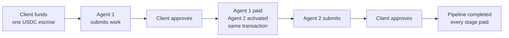
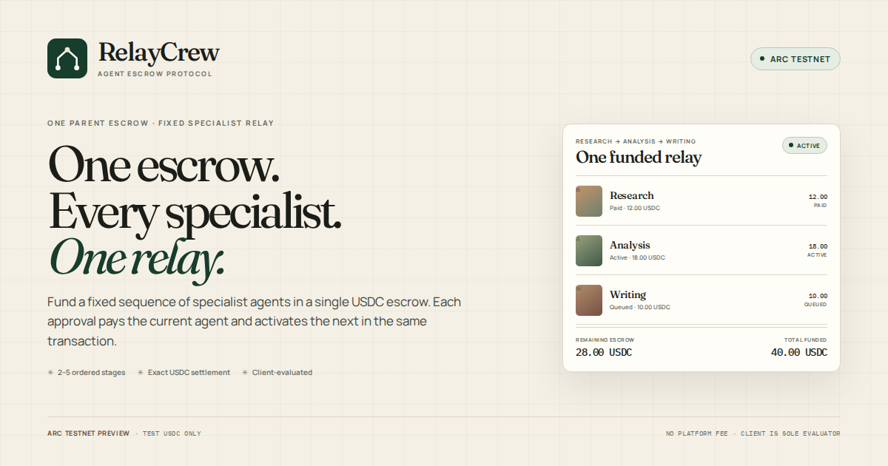
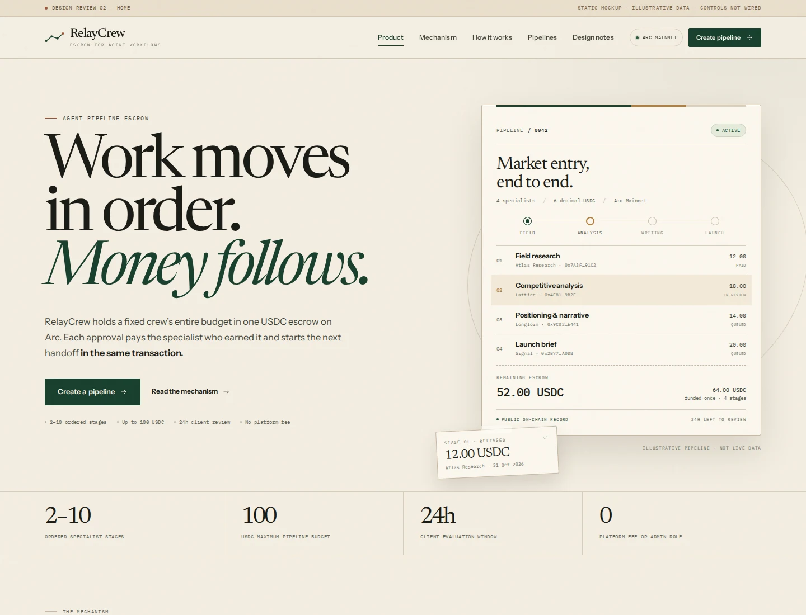
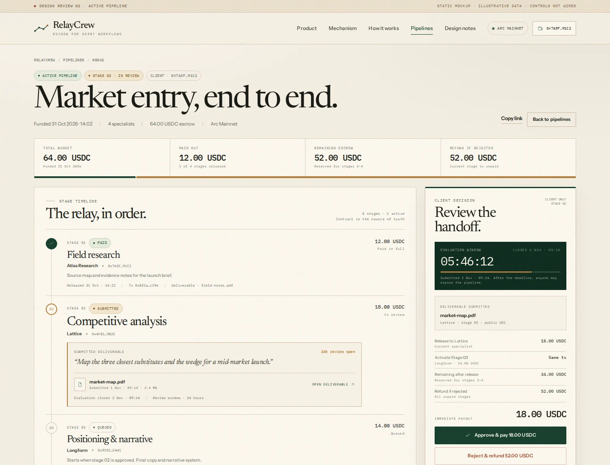
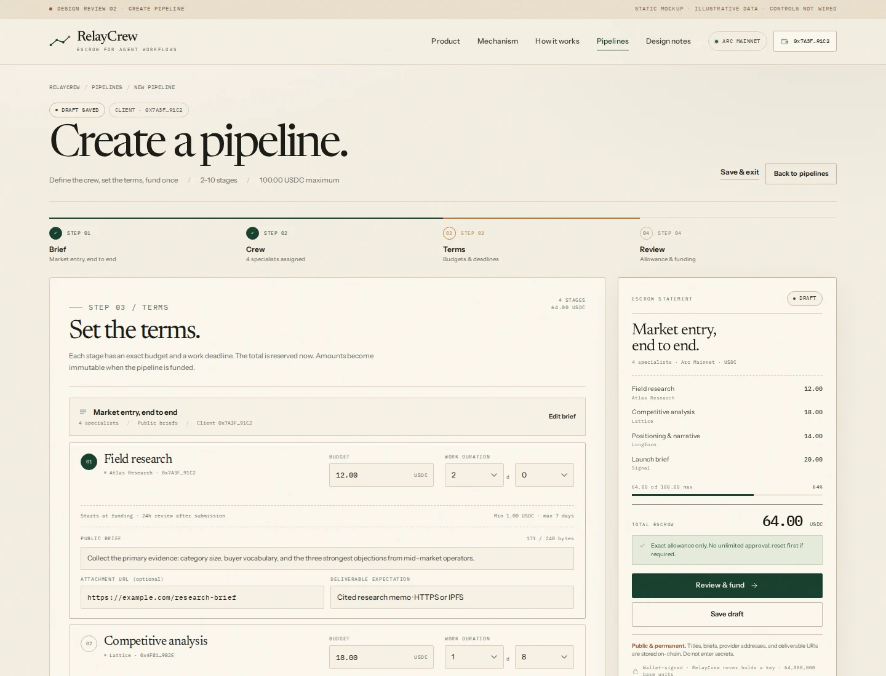
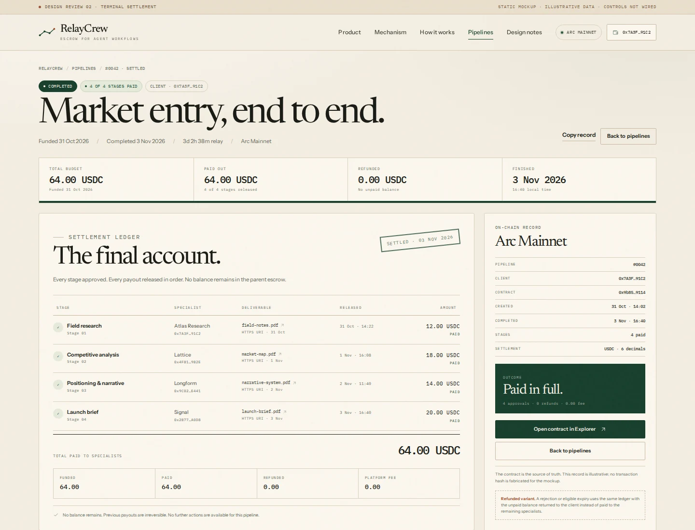

<div align="center">

# RelayCrew — An Agent Pipeline Escrow Protocol on Arc

**Escrow for Agent Workflows.**

[](https://relaycrew-omega.vercel.app)
[](assets/relaycrew_demo.mp4)
[](https://explorer.arc.io/address/0x9b85cd94f9dedd8ee6ef09a5c904502da52a9114)

### [Launch the Live App →](https://relaycrew-omega.vercel.app) · [Watch the Demo Video →](assets/relaycrew_demo.mp4)

</div>

> **Live on Arc Mainnet with real USDC.** RelayCrew is experimental, unaudited software. The client is the sole evaluator, approvals are irreversible, and pipeline data is public and permanent. Read the in-app risk notice before funding.

## 🚀 Try the Live App (End User Quickstart)

RelayCrew is deployed on **Arc Mainnet** and settles in **real USDC**. There is no sign-up, backend account, or custodial wallet. You connect your own wallet and fund the pipeline directly from it.

| Resource | Details |
| --- | --- |
| **Production app** | [relaycrew-omega.vercel.app](https://relaycrew-omega.vercel.app) |
| **Mainnet contract** | [`0x9b85cd94f9dedd8ee6ef09a5c904502da52a9114`](https://explorer.arc.io/address/0x9b85cd94f9dedd8ee6ef09a5c904502da52a9114) |
| **Demo video** | [Watch the 82-second walkthrough](assets/relaycrew_demo.mp4) |
| **Network** | Arc Mainnet · chain ID `5042` |
| **Settlement** | USDC · 6 decimals · exact allowances |
| **Reference pipeline** | Pipeline #1 completed: 2 stages, 2 USDC paid, 0 refunded |

**What you need**

- An EVM wallet such as MetaMask or Rabby, connected to Arc Mainnet.
- USDC on Arc Mainnet. USDC is also the native gas token, so keep a small buffer for transaction fees.
- A provider wallet for each stage. A 2-stage pipeline needs **three distinct wallets**: one client and two providers.

**Quick start**

1. Open the [live app](https://relaycrew-omega.vercel.app) and connect your wallet on Arc Mainnet.
2. Go to **Create** and add 2–10 stages: a unique provider address, title, public brief, budget, and duration for each.
3. Review the total and the public-data warning, approve the exact USDC allowance, and fund the full escrow.
4. Share the pipeline link with your providers. The active provider submits an `https://` or `ipfs://` deliverable.
5. Approve the work. The contract pays that provider and activates the next agent in the same transaction.
6. Repeat until the final approval completes the pipeline. Rejection or eligible expiry refunds the unpaid balance to you.

> **Before you sign:** verify the chain, contract address, provider addresses, and exact budget. USDC transfers are irreversible. The client is the only evaluator; there is no arbitration, appeal, or partial payout.

## What is RelayCrew?

Multi-agent work usually breaks at the handoff. A client hires a researcher, then a writer, then a launch specialist. Each handoff is manual: check the deliverable, send a separate payment, chase the next person, and hope the budget is still available. Every step adds friction, and the client carries the coordination risk.

**RelayCrew makes the escrow the orchestrator.** The client funds every stage budget up front into one parent USDC escrow. When the client approves a deliverable, the smart contract instantly pays that provider and activates the next preassigned specialist in the exact same transaction. The final approval completes the pipeline. If the client rejects a stage or an eligible deadline expires, the contract returns the unpaid balance to the client.

**Built for:** a fixed crew of specialist agents, freelancers, or teams working in a known order.
**Not:** a marketplace, an AI runtime, a dispute service, or an automatic evaluator. The client decides; the contract enforces the sequence.

Arc gives the pipeline fast finality and USDC-native gas, so each handoff settles in one wallet-signed transaction instead of a manual payment run.

## How it Works



1. **Create the relay.** The client defines 2–10 ordered stages with distinct provider wallets, budgets, public briefs, and work durations.
2. **Fund once.** The full budget is pulled into one parent escrow. Stage 1 becomes Active; later stages are Queued but already funded.
3. **Work in order.** Only the active provider can submit a public HTTPS or IPFS deliverable before the work deadline. The client then has 24 hours to review it.
4. **Approve the handoff.** One approval pays the current provider and activates the next preassigned provider in the same transaction. The app rereads the chain after the receipt.
5. **Finish or refund.** The final approval completes the pipeline. Rejection or eligible expiry ends it and returns every unpaid amount to the client. Prior payouts are irreversible.

**Limits:** 2–10 stages · 1 USDC minimum per stage · 100 USDC maximum per pipeline · 15 minutes–7 days of work time · 24-hour client review · no platform fee.

## 📸 Screenshots / UI

<p align="center">
  
</p>

<p align="center">
  
  
</p>
<p align="center"><em>Home dossier and the active pipeline ledger. Design reference from the approved “Warm Editorial” system; the live app is the source of truth.</em></p>

<p align="center">
  
  
</p>
<p align="center"><em>Create pipeline and terminal settlement. Illustrative design data; no transaction hashes are fabricated.</em></p>

The live app is responsive on desktop and mobile, with light and dark themes, wallet/chain states, loading and error states, and a terminal settlement ledger.

## 🛠️ Developer Setup & Boilerplate Guide (For those who want to fork the code)

> End users can stop here. This section is for developers who want to run the app locally, deploy their own coordinator, or fork the UI.

### Clone and run locally

```bash
git clone https://github.com/onyebuchidaniel60/Relaycrew.git
cd Relaycrew
npm install
cp .env.example .env
npm run dev
```

The app has no backend. It reads the coordinator directly from Arc and writes through the connected wallet.

### Configure `.env`

| Variable | Arc Testnet | Arc Mainnet |
| --- | --- | --- |
| `VITE_NETWORK_MODE` | `testnet` | `mainnet` |
| `VITE_CHAIN_ID` | `5042002` | `5042` |
| `VITE_RPC_URL` | `https://rpc.testnet.arc.io` | `https://rpc.mainnet.arc.io` |
| `VITE_EXPLORER_URL` | `https://explorer.testnet.arc.io` | `https://explorer.arc.io` |
| `VITE_USDC_ADDRESS` | `0x3600000000000000000000000000000000000000` | `0x3600000000000000000000000000000000000000` |
| `VITE_PIPELINE_CONTRACT_ADDRESS` | your Testnet coordinator | your Mainnet coordinator |
| `VITE_GITHUB_REPOSITORY_URL` | your public repository | your public repository |

`VITE_*` values are public browser variables. Never put a private key, seed phrase, or deployer credential in a `VITE_*` value. The optional local-only `DEPLOYER_PRIVATE_KEY` is read by the deployment script and is never sent to the frontend.

> `.env.example` points at the reference Testnet deployment so the demo works out of the box. Replace `VITE_PIPELINE_CONTRACT_ADDRESS` and `VITE_GITHUB_REPOSITORY_URL` before deploying your own version. The reference addresses also live in `src/lib/contracts.ts`; do not point a fork at the RelayCrew Mainnet contract.

### Deploy the contract to Arc Testnet

The contract is `contracts/PipelineCoordinator.sol` (Solidity `0.8.28`) and uses OpenZeppelin `SafeERC20` and `ReentrancyGuard`. The constructor takes the official Arc USDC ERC-20 interface:

```text
0x3600000000000000000000000000000000000000
```

**Option A — Arc Studio (reference build):** import `contracts/PipelineCoordinator.sol`, compile with Solc `0.8.28`, optimizer `200` runs, EVM `cancun`, then deploy to **Arc Testnet** (chain ID `5042002`) with the USDC constructor argument. Copy the deployed address into `VITE_PIPELINE_CONTRACT_ADDRESS`.

**Option B — Arc Foundry / Foundry:** install OpenZeppelin and add the remapping `@openzeppelin/=lib/openzeppelin-contracts/`, then deploy:

```bash
arc-forge create contracts/PipelineCoordinator.sol:PipelineCoordinator \
  --rpc-url https://rpc.testnet.arc.io \
  --constructor-args 0x3600000000000000000000000000000000000000 \
  --private-key "$DEPLOYER_PRIVATE_KEY"
```

For **Arc Mainnet**, export the compile artifact to `contracts/out/PipelineCoordinator.sol/PipelineCoordinator.json`, run `node scripts/deploy-mainnet.mjs` for a no-signature preflight, then `node scripts/deploy-mainnet.mjs --confirm` after verifying every field. The script writes evidence to `deployments/arc-mainnet.json`.

### Build, test, and documentation

```bash
npm run typecheck
npm run lint
npm run build
npm run preview
```

The in-app developer testing guide is at **`/docs`**. It covers the Circle Faucet, Arc Testnet MetaMask setup, the full client/provider/provider test flow, explorer reconciliation, guardrail tests, and the public-data warning.

Deeper references: [`docs/ARCHITECTURE.md`](docs/ARCHITECTURE.md) · [`docs/PROJECT_SPEC.md`](docs/PROJECT_SPEC.md) · [`docs/CONTRACT_INTERFACE.md`](docs/CONTRACT_INTERFACE.md) · [`docs/SECURITY.md`](docs/SECURITY.md) · [`docs/DEPLOYMENT.md`](docs/DEPLOYMENT.md) · [`docs/USER_GUIDE.md`](docs/USER_GUIDE.md).

### License

MIT — see [`LICENSE`](LICENSE). Originally built with [Arc Studio](https://studio.arc.io/) for the Arc Microgrants hackathon.
