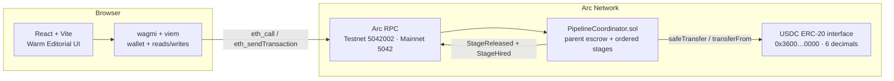

<div align="center">

# RelayCrew Boilerplate

**An Agent Pipeline Escrow Protocol on Arc**

[](https://react.dev)
[](https://www.typescriptlang.org/)
[](https://vite.dev/)
[](https://wagmi.sh/)
[](https://docs.arc.io/)
[](https://www.circle.com/usdc)
[](https://studio.arc.io/)
[](LICENSE)

A frontend-complete, contract-tested template for fixed-sequence agent escrows on Arc. Fork it, swap the briefs and wallets, deploy your own coordinator, and run a multi-agent pipeline with one parent USDC escrow.

</div>

> **Experimental software.** The reference contract is unaudited. The client is the sole evaluator, there is no dispute mechanism, and on-chain data is permanent. Use Arc Testnet and test USDC first. Never put secrets or sensitive task data on chain.

## Table of contents

- [🚀 Quickstart](#-quickstart)
- [🏗️ Architecture](#️-architecture)
- [✨ Features of the Boilerplate](#-features-of-the-boilerplate)
- [🛠️ How to Build Your Own Pipeline](#️-how-to-build-your-own-pipeline)
- [🔗 The “RelayCrew” Reference Implementation](#-the-relaycrew-reference-implementation-hackathon-demo)
- [📚 Documentation](#-documentation)
- [🧪 Tests and Quality Gates](#-tests-and-quality-gates)
- [🔒 Security Notes](#-security-notes)
- [📄 License](#-license)

## 🚀 Quickstart

### 0. Prerequisites

- Node.js 20 or newer (the reference build was verified with Node 26).
- npm, Git, and an EVM wallet such as MetaMask or Rabby.
- No backend, database, indexer, or API keys are required.
- For transactions: test USDC from the [Circle Faucet](https://faucet.circle.com/) on Arc Testnet.

Arc uses **USDC as its native gas token**, so you do not need ETH. The app talks to the optional USDC ERC-20 interface, which uses **6 decimals**; the native gas balance uses 18 decimals. Do not mix the two representations.

### 1. Clone and install

```bash
git clone https://github.com/onyebuchidaniel60/Relaycrew.git
cd Relaycrew
npm install
```

### 2. Configure `.env`

```bash
cp .env.example .env
```

| Variable | Arc Testnet | Arc Mainnet |
| --- | --- | --- |
| `VITE_NETWORK_MODE` | `testnet` | `mainnet` |
| `VITE_CHAIN_ID` | `5042002` | `5042` |
| `VITE_RPC_URL` | `https://rpc.testnet.arc.io` | `https://rpc.mainnet.arc.io` |
| `VITE_EXPLORER_URL` | `https://explorer.testnet.arc.io` | `https://explorer.arc.io` |
| `VITE_USDC_ADDRESS` | `0x3600000000000000000000000000000000000000` | `0x3600000000000000000000000000000000000000` |
| `VITE_PIPELINE_CONTRACT_ADDRESS` | your deployed coordinator | your deployed coordinator |
| `VITE_GITHUB_REPOSITORY_URL` | your public repository | your public repository |

`VITE_*` values are public and are embedded in the browser bundle. **Never put a private key, seed phrase, Circle secret, or deployer credential in a `VITE_*` variable.** The optional local-only `DEPLOYER_PRIVATE_KEY` is read by the deployment script from `.env` and is never sent to the frontend.

> The checked-in `.env.example` points at the reference Testnet deployment so you can inspect the demo immediately. Replace `VITE_PIPELINE_CONTRACT_ADDRESS` and `VITE_GITHUB_REPOSITORY_URL` before deploying your own version. The reference addresses are also listed in `src/lib/contracts.ts`; do not point a fork at the RelayCrew Mainnet contract.

### 3. Run locally

```bash
npm run dev          # Vite dev server
npm run typecheck    # TypeScript, no emit
npm run lint         # oxlint
npm run build        # typecheck + production build
npm run preview      # preview the production build
```

Open the local URL printed by Vite. The app reads the pipeline directly from Arc; there is no backend to start.

### 4. Deploy the smart contract

The contract is `contracts/PipelineCoordinator.sol` (Solidity `0.8.28`). It imports OpenZeppelin `SafeERC20` and `ReentrancyGuard`. The constructor takes the official Arc USDC ERC-20 interface:

```text
0x3600000000000000000000000000000000000000
```

#### Arc Testnet

The reference build was compiled and deployed from **Arc Studio**, which supplies the OpenZeppelin imports:

1. Import `contracts/PipelineCoordinator.sol` into an Arc Studio project.
2. Compile with Solc `0.8.28`, optimizer `200` runs, EVM `cancun`.
3. Deploy to **Arc Testnet** (chain ID `5042002`) with the USDC constructor argument.
4. Copy the deployed address into `VITE_PIPELINE_CONTRACT_ADDRESS`.

If you prefer a local toolchain, install [Arc Foundry](https://docs.arc.io/arc/tutorials/install-arc-foundry) or Foundry, add OpenZeppelin and the remapping `@openzeppelin/=lib/openzeppelin-contracts/`, then deploy with your normal `forge create` / `arc-forge create` flow:

```bash
arc-forge create contracts/PipelineCoordinator.sol:PipelineCoordinator \
  --rpc-url https://rpc.testnet.arc.io \
  --constructor-args 0x3600000000000000000000000000000000000000 \
  --private-key "$DEPLOYER_PRIVATE_KEY"
```

#### Arc Mainnet

The repository includes a guarded deployment script that consumes an exported compile artifact:

```text
contracts/out/PipelineCoordinator.sol/PipelineCoordinator.json
```

Export that artifact from Arc Studio or your local toolchain, then:

```bash
# 1. Preflight only — no signature, no broadcast
node scripts/deploy-mainnet.mjs

# 2. Verify the chain, predicted address, gas cap, and constructor argument
# 3. Broadcast only after the preflight is correct
node scripts/deploy-mainnet.mjs --confirm
```

The script checks the source/artifact hash, chain ID `5042`, the official USDC interface, the predicted contract address, and the deployed `usdc()` / `MAX_STAGES()` values. It writes evidence to `deployments/arc-mainnet.json`. It never prints the private key.

### 5. Point the app at your contract

Set `VITE_PIPELINE_CONTRACT_ADDRESS` in `.env` (local) and in your hosting provider's environment (production). If you change the contract interface, update the ABI and address map in `src/lib/contracts.ts` and the hooks in `src/hooks/`.

### 6. Deploy the frontend

The reference app is deployed on Vercel:

```bash
npm run build
vercel --prod
```

Set the same `VITE_*` variables in Vercel. `vite.config.ts` includes safety guards used by the reference deployment: Vercel **Preview** builds must be Arc Testnet, and Vercel **Production** builds must be Arc Mainnet with chain `5042` and the official USDC interface. Adjust those guards if your deployment model is different.

## 🏗️ Architecture



**The flow in one sentence:** the client funds every stage budget into one parent escrow; the active provider submits a deliverable URI; the client approves; the contract pays that provider and activates the next preassigned provider in the same transaction.

| Layer | What it does |
| --- | --- |
| React + Vite | Wallet-driven UI, create form, pipeline ledger, terminal states, docs and risk pages. |
| wagmi + viem | Injected-wallet connection, Arc chain switching, typed contract reads/writes, receipt handling. |
| `PipelineCoordinator.sol` | Holds the parent escrow, enforces stage order and permissions, pays on approval, refunds on rejection/expiry. |
| Arc USDC | The ERC-20 interface used for exact allowances and payouts. Native USDC also pays gas. |

The contract is the source of truth. The UI rereads after every receipt and does not use a backend, database, indexer, queue, or off-chain listener.

## ✨ Features of the Boilerplate

- **2–10 stage linear pipelines.** Providers, order, budgets, briefs, and durations are fixed at funding.
- **Atomic payout + next-agent activation.** One approval pays the current provider and activates the next stage in the same transaction.
- **Upfront USDC escrow.** The full pipeline budget is pulled once and reserved in the parent escrow.
- **Exact allowance handling.** The app requests the exact total, not an unlimited allowance.
- **Client-only evaluation.** The client approves or rejects each stage; there is no arbitration or automatic AI judge.
- **Rejection and expiry refunds.** Unpaid budget returns to the client; prior payouts are irreversible.
- **Immutable terms.** Stage order, providers, budgets, titles, briefs, and durations cannot be changed after funding.
- **Responsive “Warm Editorial” UI.** Newsreader / Instrument Sans / IBM Plex Mono, ivory/forest/sage/clay tokens, light and dark themes, mobile layouts, loading/empty/error/terminal states.
- **No backend or admin surface.** No database, indexer, queue, admin withdrawal, upgrade path, fee, or rescue function.
- **Testable by design.** The reference contract suite covers creation bounds, permissions, atomic release/hire, rejection refunds, expiry refunds, and invalid calls.

## 🛠️ How to Build Your Own Pipeline

### 1. Fork and rename

```bash
git clone https://github.com/onyebuchidaniel60/Relaycrew.git my-pipeline
cd my-pipeline
npm install
```

Update the brand in `index.html`, `src/components/AppShell.tsx`, `src/components/LogoMark.tsx`, `public/`, and this README. Keep the MIT license notice or replace it with your own.

### 2. Change the protocol parameters

Start with the constants at the top of `contracts/PipelineCoordinator.sol`:

| Constant | Reference value | What to change |
| --- | --- | --- |
| `MIN_STAGES` / `MAX_STAGES` | `2` / `10` | Pipeline length bounds. |
| `MIN_STAGE_BUDGET` | `1 USDC` (`1_000_000`) | Minimum budget per stage. |
| `MAX_PIPELINE_BUDGET` | `100 USDC` (`100_000_000`) | Maximum total budget. |
| `MIN_STAGE_DURATION` / `MAX_STAGE_DURATION` | `900` / `604_800` seconds | Work window bounds. |
| `EVALUATION_WINDOW` | `86_400` seconds (24h) | Client review window after submission. |
| `MIN_TITLE_BYTES` / `MAX_TITLE_BYTES` | `1` / `64` | Public title bounds. |
| `MIN_BRIEF_BYTES` / `MAX_BRIEF_BYTES` | `1` / `240` | Public brief bounds. |
| `MIN_URI_BYTES` / `MAX_URI_BYTES` | `9` / `256` | Deliverable URI bounds. |

If you change a struct, function signature, event, or error, update the ABI in `src/lib/contracts.ts` and the calls in `src/hooks/` and `src/pages/`. Keep the checks-effects-interactions pattern, `SafeERC20`, and `nonReentrant` on every transfer-bearing method.

### 3. Decide your product policy

The reference implementation is intentionally narrow. Before changing it, write down:

- Who evaluates a stage? The reference uses the client for every stage.
- What happens on rejection or expiry? The reference refunds all unpaid budget and ends the pipeline.
- Are prior payouts reversible? The reference makes them final.
- Is there a fee, admin role, upgrade path, or rescue function? The reference has none.
- Are providers unique? Yes: duplicate providers and the client address are rejected.
- What data is public? Titles, briefs, provider addresses, budgets, URIs, and transactions are permanent.

If you add arbitration, reputation, discovery, fees, or upgradeability, you are changing the trust model. Document it and audit it before using real funds.

### 4. Deploy your coordinator

Deploy `PipelineCoordinator.sol` with the official Arc USDC interface as the constructor argument. For Testnet, use chain `5042002`; for Mainnet, chain `5042`. Verify the deployed `usdc()` value and `MAX_STAGES()` before pointing the UI at it.

### 5. Wire the frontend

1. Set `VITE_NETWORK_MODE`, `VITE_CHAIN_ID`, `VITE_RPC_URL`, `VITE_EXPLORER_URL`, and `VITE_USDC_ADDRESS`.
2. Set `VITE_PIPELINE_CONTRACT_ADDRESS` to your coordinator.
3. Update the reference address map in `src/lib/contracts.ts` or rely on the env var.
4. Update the footer repository URL with `VITE_GITHUB_REPOSITORY_URL`.
5. Run `npm run typecheck`, `npm run lint`, and `npm run build`.

### 6. Customize the interface

- Theme tokens and component styles: `src/editorial.css`, `src/index.css`, `tailwind.config.js`.
- Navigation, footer, and wallet control: `src/components/AppShell.tsx`.
- Create form and validation: `src/pages/CreatePipelinePage.tsx`, `src/lib/validation.ts`.
- Pipeline ledger and actions: `src/pages/PipelineDetailPage.tsx`, `src/lib/pipelineDisplay.ts`.
- In-app developer guide: `src/pages/DocsPage.tsx`.
- Risk notice: `src/pages/RiskPage.tsx`.

Keep the public-data warning visible before creation and submission. Do not fetch, embed, or proxy user-supplied deliverable URLs; render them as safe external links only.

### 7. Test with separate wallets

Use three wallets on Arc Testnet: a client and two distinct providers. Fund the client with test USDC, create a 2-stage pipeline, submit from provider 1, approve from the client, submit from provider 2, and approve the final stage. Reconcile the 1 USDC payouts and the zero remaining balance in the explorer. Then test rejection and expiry on separate pipelines.

### 8. Production checklist

- Independent security review of your modified contract.
- Verify the contract source on the explorer.
- Use a dedicated deployment key; never put it in the frontend or hosting env.
- Confirm chain ID, USDC address, coordinator address, provider addresses, and exact budgets before signing.
- Test the deployed app on mobile and desktop, including wrong-chain, rejected-wallet, reverted-transaction, stale-RPC, and terminal-state paths.
- Keep the risk notice and public-data warning visible.
- Decide whether your legal, privacy, and data-retention obligations require changes.

## 🔗 The “RelayCrew” Reference Implementation (Hackathon Demo)

This repository was used to build **RelayCrew** for the **Arc Microgrants: Built with Arc Studio** hackathon. The reference deployment is a completed 2-stage Mainnet pipeline with real USDC.

| Resource | Link |
| --- | --- |
| **Live app** | [relaycrew-omega.vercel.app](https://relaycrew-omega.vercel.app) |
| **Demo video** | [assets/relaycrew_demo.mp4](assets/relaycrew_demo.mp4) |
| **Mainnet contract** | [`0x9b85cd94f9dedd8ee6ef09a5c904502da52a9114`](https://explorer.arc.io/address/0x9b85cd94f9dedd8ee6ef09a5c904502da52a9114) |
| **Arc Studio project** | [App ID `9ad3cdcd-b77f-4cd3-9b03-c6dbb9704961`](https://studio.arc.io/app/9ad3cdcd-b77f-4cd3-9b03-c6dbb9704961) (requires Arc Studio sign-in) |
| **Public source** | [github.com/onyebuchidaniel60/Relaycrew](https://github.com/onyebuchidaniel60/Relaycrew) |

**Verified Mainnet evidence (2026-11-02):**

- Create/fund: [`0x12b1b81d4b34eeb00cb857f6fea615351429767597285d51dc354d528ced5361`](https://explorer.arc.io/tx/0x12b1b81d4b34eeb00cb857f6fea615351429767597285d51dc354d528ced5361)
- Stage 1 approve: [`0xfddd46b6b322a1f3b66efc4b99626e862d2bfd7d7a12c0f0306a422b5cbc9e62`](https://explorer.arc.io/tx/0xfddd46b6b322a1f3b66efc4b99626e862d2bfd7d7a12c0f0306a422b5cbc9e62)
- Stage 2 approve: [`0x2f1929bb583352c8f2c6c7e1231acdad777e17227ab4be9f4563aaebd849785b`](https://explorer.arc.io/tx/0x2f1929bb583352c8f2c6c7e1231acdad777e17227ab4be9f4563aaebd849785b)

Pipeline #1 is `Completed`: 2 stages, 2 USDC funded, 2 USDC paid, 0 refunded. The operator-supplied “create/fund” hash `0x45bdd5…8e55` is the USDC allowance approval, not the creation; the create/fund hash above is the verified `PipelineCreated` transaction.

> The reference deployment is provided as evidence, not as a production service. Do not send funds to it. Deploy your own contract and use your own provider wallets.

## 📚 Documentation

| Document | Purpose |
| --- | --- |
| [`docs/ARCHITECTURE.md`](docs/ARCHITECTURE.md) | Contract design, state machine, permissions, data, security, and deployment model. |
| [`docs/PROJECT_SPEC.md`](docs/PROJECT_SPEC.md) | Product behavior, roles, flows, requirements, and acceptance criteria. |
| [`docs/CONTRACT_INTERFACE.md`](docs/CONTRACT_INTERFACE.md) | Functions, events, errors, and on-chain data shapes. |
| [`docs/SECURITY.md`](docs/SECURITY.md) | Threat model, invariants, and operational safety. |
| [`docs/DEPLOYMENT.md`](docs/DEPLOYMENT.md) | Network configuration and deployment evidence. |
| [`docs/USER_GUIDE.md`](docs/USER_GUIDE.md) | End-user walkthrough for the reference app. |
| [`docs/DECISIONS.md`](docs/DECISIONS.md) | Architecture and product decisions. |
| [`docs/DESIGN_DECISIONS.md`](docs/DESIGN_DECISIONS.md) | Visual system, references, and approval record. |
| [`docs/REQUIREMENT_MATRIX.md`](docs/REQUIREMENT_MATRIX.md) | Feature-by-feature acceptance and edge-case matrix. |
| [`docs/SOURCES.md`](docs/SOURCES.md) | Official Arc and Circle references. |
| [`docs/AI_HANDOFF.md`](docs/AI_HANDOFF.md) | Internal build record and current project state. |

The in-app developer guide lives at **`/docs`** and includes faucet, MetaMask, local testing, and escrow-flow instructions.

## 🧪 Tests and Quality Gates

The reference contract suite is in `contracts/test/PipelineCoordinator.t.sol` and covers **31 Foundry tests**, including:

- creation bounds and duplicate/nonzero provider checks;
- exact budget and duration validation;
- submit permissions and URI validation;
- atomic `StageReleased` + `StageHired` behavior;
- final approval completion;
- rejection and expiry refunds;
- double-approve, wrong-stage, non-client, and early-expiry reverts.

Run the frontend gates before every deployment:

```bash
npm run typecheck
npm run lint
npm run build
```

If you use Arc Foundry or Foundry locally, configure the OpenZeppelin remapping and run `arc-forge test` / `forge test` against the contract suite.

## 🔒 Security Notes

- The reference contract is **unaudited**. Treat it as a starting point, not a production guarantee.
- The client is the sole evaluator. There is no arbitration, appeal, dispute, or automatic fairness mechanism.
- Approval and rejection are irreversible. Prior payouts cannot be reversed.
- Pipeline titles, briefs, provider addresses, budgets, deliverable URIs, and transactions are public and permanent.
- Never enter secrets, personal data, credentials, confidential instructions, or private document URLs.
- Use exact USDC allowances, not unlimited allowances. Reset an existing allowance if your token behavior requires it.
- All transfer-bearing methods use `SafeERC20`, `nonReentrant`, and checks-effects-interactions.
- Verify chain ID, USDC address, coordinator address, recipients, and exact amounts before signing.
- Never put `DEPLOYER_PRIVATE_KEY` in Vercel, browser env, screenshots, prompts, or Git.

See [`docs/SECURITY.md`](docs/SECURITY.md) and the in-app `/risk` page for the full risk notice.

## 📄 License

MIT — see [`LICENSE`](LICENSE).

Built with [Arc Studio](https://studio.arc.io/) for the Arc ecosystem.
